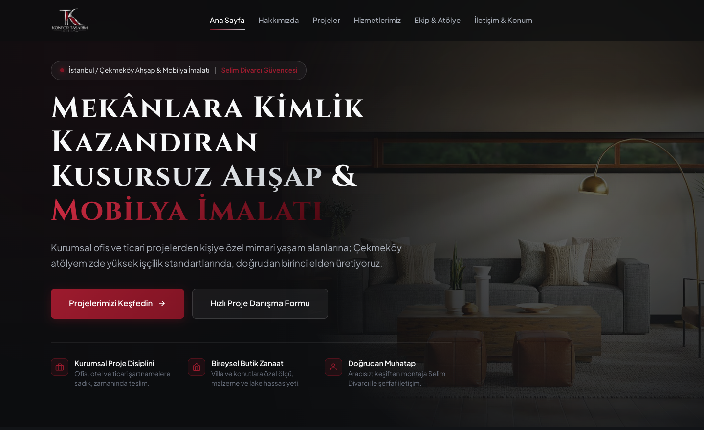
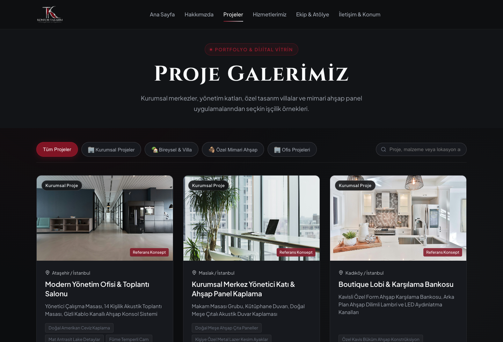
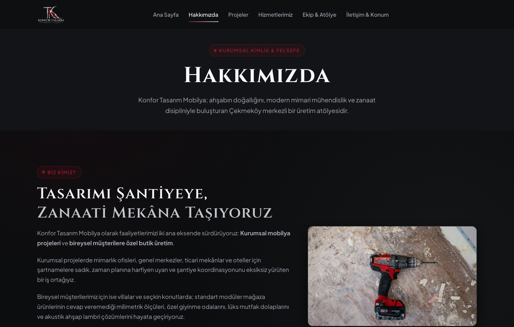
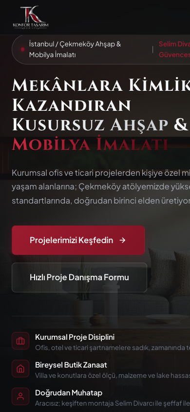

# Mobilya & Mimari Proje Vitrini (Corporate Furniture Showcase)

Modern, lüks ve özgün kurumsal mobilya projeleri ile özel mimari ahşap uygulamalarını sergilemek üzere geliştirilmiş **Dijital Vitrin ve Portfolyo Web Sitesi**.

Bu proje, e-ticaret karmaşasından uzak; B2B kurumsal projelerin (ofis, otel, ticari alan) ve butik mimari konut/villa imalatlarının zanaat ve mühendislik detaylarıyla sergilendiği, ziyaretçilerin doğrudan yetkiliyle iletişim kurabildiği modern bir mimari vitrindir.

---

## 🖼️ Proje & Arayüz Vitrini (Showcase)

Web sitesinin mimari karanlık lüks konseptini, tipografisini ve duyarlı (responsive) tasarımını yansıtan arayüz görüntüleri:

### 🌟 Ana Sayfa & Hero Alanı
> Derin obsidyen arka plan, heykelsi Cinzel tipografi ve birinci elden üretim felsefesini öne çıkaran manşet alanı.



---

### 🏛️ Proje Galerisi & Filtreleme Arayüzü
> Kurumsal, bireysel konut ve mimari ahşap kategorilerine göre anlık filtrelenebilen, malzeme etiketli portfolyo kartları.



---

### 🪵 Kurumsal Kimlik & Atölye Zanaati
> Çekmeköy atölye kültürü, 4 adımlı anahtar teslim iş akışı ve mimari malzeme standartlarının anlatıldığı kurumsal sayfa.



---

### 📱 Mobil & Duyarlı Tasarım
> Masaüstünden akıllı telefonlara kadar kusursuz uyum sağlayan responsive tipografi ve kart düzeni.

<p align="center">
  
</p>

---

## 🛠️ Nasıl Yapıldı? (Proje Mimarisi & Teknolojiler)

Proje, harici ağır kütüphanelere (React/Next.js/Webpack vb.) ihtiyaç duymadan, ışık hızında yüklenen ve sürdürülebilir bir kod yapısıyla geliştirilmiştir:

### 1. Ön Yüz & Tasarım Sistemi (UI/UX)
- **Tasarım Belirteçleri (CSS Custom Properties):** Bordo vurgular (`#801424`), metalik krom (`#C5C9CE`), derin obsidyen arka plan (`#0C0D0F`) ve doğal sıcak ahşap tonları (`#B3865D`) ile oluşturulmuş tutarlı renk sistemi.
- **Tipografi:** Başlıklarda heykelsi zarafet sunan `Cinzel`, okunabilirlik için `Plus Jakarta Sans`.
- **Modüler CSS Mimarisi:** `variables.css`, `base.css`, `layout.css`, `components.css` ve `responsive.css` olarak ayrılmış, çakışmayan katmanlar.
- **Mikro Etkileşimler:** Akıcı cam efekti (glassmorphism), kaydırma duyarlı navbar, interaktif modal lightbox ve responsive mobil çekmece menü.

### 2. Veri Soyutlama Katmanı (DataStore Pattern)
- **Tek Gerçeklik Kaynağı (Single Source of Truth):** Proje, hizmet ve şirket bilgileri HTML içine gömülmek yerine `data/` klasöründeki şematik JSON dosyalarında (`projects.json`, `company.json`, `services.json`, `team.json`) tutulur.
- **Çift Modlu Veri Erişimi (`assets/js/data/store.js`):** Sitenin hem sunucusuz çift tıklamayla (`file://`) hem de web sunucusu üzerinden (`http://`) çalışmasını sağlar; HTTP ortamındaysa dinamik `/api/projects` uç noktalarından veri çeker.

### 3. Temiz URL (.html Uzantısız) Yönlendirme
- Sayfa içi tüm linkler `.html` uzantısı olmadan (`/`, `/projeler`, `/hakkimizda`, `/iletisim`) çalışır.
- Yayın ortamı için hem bulut sistemleri (`vercel.json`) hem geleneksel cPanel/Apache sunucuları (`.htaccess` mod_rewrite) ve Nginx için tam yapılandırılmıştır.
- Eski `.html` adreslerine gelen istekler SEO puanını korumak için `301 Kalıcı Yönlendirme` ile temiz URL'lere aktarılır.

### 4. Dahili Node.js Sunucusu & REST API Mock
- Sıfır harici paket bağımlılığıyla çalışan saf Node.js sunucusu (`server.js`).
- `/api/projects` ve `/api/company` GET servisleri.
- Ziyaretçilerin web formundan gönderdiği proje danışma taleplerini yakalayıp `data/inquiries.json` dosyasına kaydeden ve tek tıkla mesajlaşma formatına dönüştüren `/api/inquiry` POST servisi.

---

## 📂 Dosya & Dizin Yapısı

```
├── index.html              # Ana Dijital Vitrin (Hero, Değerler, Vitrin, Hizmetler, Ekip, İletişim)
├── hakkimizda.html         # Kurumsal Hikaye, Atölye Kültürü, 4 Aşamalı Süreç, Malzeme Standartları
├── projeler.html           # Filtrelenebilir Proje Galerisi, Canlı Arama, Lightbox Modal
├── iletisim.html           # İletişim, Harita Entegrasyonu & Hızlı Danışma Formu
├── server.js               # Yerel Node.js HTTP sunucusu ve REST API motoru
├── test-routes.js          # Rota ve temiz URL otomatik test paketi
├── package.json            # Proje scriptleri (start, test, dev)
├── vercel.json             # Vercel temiz URL yapılandırması
├── .htaccess               # Apache / cPanel mod_rewrite kuralları
├── data/                   # JSON Veri Modelleri (Şablon / Dummy)
│   ├── company.json        # Firma ve iletişim şablon verisi
│   ├── projects.json       # Proje portfolyosu, malzemeler ve kategoriler
│   ├── services.json       # Hizmet kalemleri ve avantajlar
│   ├── team.json           # Atölye birimleri ve ekip yapısı
│   └── inquiries.json      # Gelen form talepleri veritabanı
├── assets/
│   ├── css/                # Tasarım belirteçleri ve stil sayfaları
│   ├── js/                 # Galeri, form ve uygulama kontrolcüleri
│   └── images/             # Logo, manşet ve mimari referans fotoğrafları
└── docs/                   # Mimari ve sunucu kurulum kılavuzları
    ├── ARCHITECTURE.md     # Gelecek Admin Paneli & SQL/Prisma DB entegrasyon rehberi
    ├── DEPLOYMENT.md       # Vercel, cPanel, Nginx ve PM2 yayınlama rehberi
    └── screenshots/        # Vitrin ve arayüz önizleme ekran görüntüleri
```

---

## 🚀 Kurulum & Çalıştırma

Projeyi çalıştırmak için 3 farklı yöntem mevcuttur:

### 1. Dahili Sunucu ile Çalıştırma (Önerilen)
```bash
# Sunucuyu başlatın
npm start
# veya
node server.js
```
Tarayıcınızda açın: **`http://localhost:3030`**

### 2. Otomatik Rota Testlerini Çalıştırma
```bash
npm test
```
Tüm temiz URL yönlendirmelerini, 301 yönlendirmelerini ve API yanıtlarını otomatik test eder.

### 3. Sunucusuz Açma
Herhangi bir kurulum yapmadan doğrudan `index.html` dosyasına çift tıklayarak tarayıcınızda açabilirsiniz.

---

## ⚙️ Yapılandırma & Şablon Bilgileri (Dummy Data)

Projeyi kendi firmanıza veya müşterinize göre özelleştirmek için `data/company.json` dosyasındaki şablon alanları düzenleyebilirsiniz:

```json
{
  "company": {
    "name": "Örnek Mobilya Tasarım & Uygulama",
    "authorizedPerson": {
      "name": "Firma Yetkilisi / Proje Yöneticisi",
      "title": "Proje Koordinatörü",
      "phone": "+90 5XX XXX XX XX",
      "email": "info@ornek-mobilya.com"
    },
    "contact": {
      "phone": "+90 5XX XXX XX XX",
      "email": "info@ornek-mobilya.com",
      "address": {
        "full": "Örnek Mah. Sanayi Cad. No:1, İstanbul / Türkiye"
      }
    }
  }
}
```

---

## 🔒 Güvenlik & Gizlilik
- Bu açık kaynaklı repoda gerçek şahıslara ait kişisel veriler, özel telefon numaraları veya lisanssız ticari bilgiler yer almamaktadır.
- README vitrinindeki ve web arayüzündeki tüm önizlemeler gizlilik normlarına uygun olarak hassas iletişim bilgileri (telefon, e-posta vb.) gizlenerek hazırlanmıştır.
- Form alanları ve iletişim bağlantıları yerel şablon / dummy parametrelerle çalışmaktadır.
